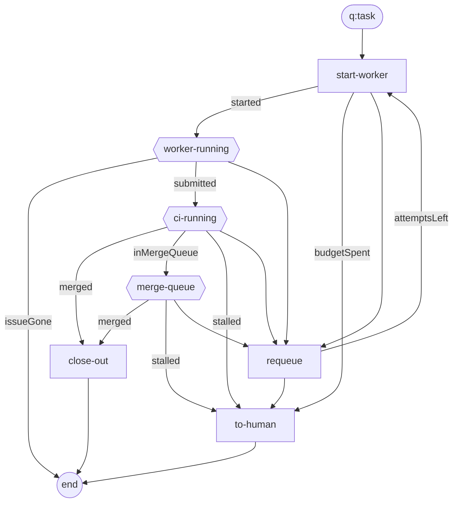
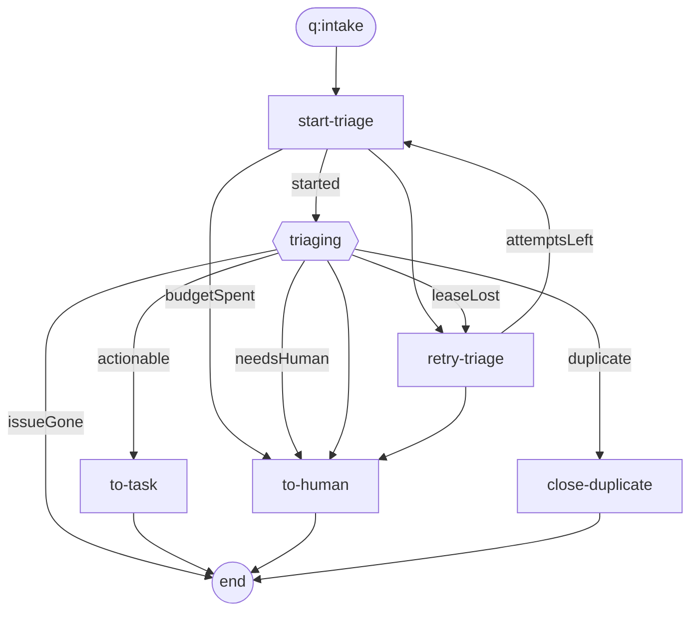
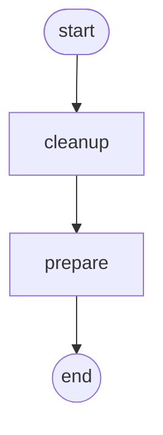
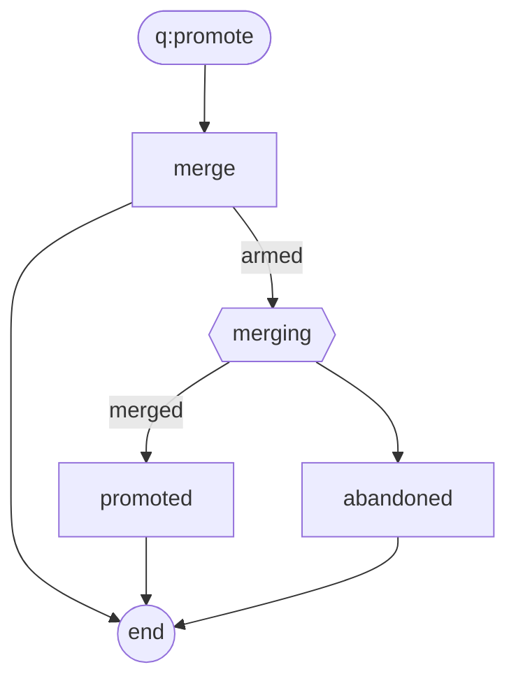

# cambium

The scheduler daemon. Every tick it reads the `q:*` queues from GitHub, starts headless `claude -p` workers in their own worktrees up to a cap, watches their PRs through CI and the merge queue, and makes every queue transition itself. GitHub is the truth; local SQLite only remembers which processes it started.

This is the **Task phase** MVP. With `engine: "graph"`, `q:intake` issues are triaged by the [`dispatch` graph](#the-dispatch-graph) and Release runs as graphs; on the legacy engine both are seams (see [Follow-ups](#follow-ups)).

Runtime dependencies: `zod` (the [graph module](#graph-module-preview)) and OpenTelemetry via `@oakgreencc/mycelium` (loaded only when [tracing](#tracing) is on); Node ≥ 22.13 (`node:sqlite`). GitHub access goes through [`graft`](../graft), which must be on `PATH`.

## Quick start

```sh
npm install -g @oakgreencc/cambium @oakgreencc/graft
mkdir -p ~/.cambium && $EDITOR ~/.cambium/config.json   # see Configuration
cambium start --once          # one tick in the foreground
cambium install               # writes ~/Library/LaunchAgents/com.oakgreencc.cambium.plist
launchctl bootstrap gui/$(id -u) ~/Library/LaunchAgents/com.oakgreencc.cambium.plist
cambium status
```

## Commands

| Command                                                            | What                                                                                                                                                                                                                                                                                                                                                      |
| ------------------------------------------------------------------ | --------------------------------------------------------------------------------------------------------------------------------------------------------------------------------------------------------------------------------------------------------------------------------------------------------------------------------------------------------- |
| `cambium start [--once]`                                           | Foreground daemon, one tick every `tickSeconds`. SIGTERM/SIGINT stop it after the current tick; workers keep running and are re-adopted on restart. One daemon per database.                                                                                                                                                                              |
| `cambium status [--json]`                                          | Mode, last tick, queue counts, workers, failed steps. Exit 1 when there is no heartbeat or it is older than 3 ticks.                                                                                                                                                                                                                                      |
| `cambium pause`                                                    | Read and heartbeat only: no transitions, no starts. Running workers are left alone.                                                                                                                                                                                                                                                                       |
| `cambium drain`                                                    | Reconcile, watch and sweep as usual; start nothing new.                                                                                                                                                                                                                                                                                                   |
| `cambium resume`                                                   | Back to `running`.                                                                                                                                                                                                                                                                                                                                        |
| `cambium run task --issue <n> [--repo <owner/name>]`               | Claim one open `q:task` issue, run its worker in the foreground, then make the same transition the daemon would.                                                                                                                                                                                                                                          |
| `cambium run <graph> --issue <n> [--repo <owner/name>] [--follow]` | `engine: "graph"` only (`task` is the one graph today). Advance one issue through the graph runtime in the foreground: a `q:task` issue without a lease starts with a foreground worker; anything else resumes where its marker rests. Stops at the first wait that is not ready; `--follow` re-reads and polls every `tickSeconds` until the graph ends. |
| `cambium install [--dry-run]`                                      | Write the launchd agent (`KeepAlive`, `RunAtLoad`) for `start --config <this config>`; `--dry-run` prints it. It does not call `launchctl`; it prints the command.                                                                                                                                                                                        |
| `cambium update [--check] [--version <v>]`                         | Install the latest version (or `<v>`, even an older one) from npm into this global install, then SIGTERM the launchd agent so it finishes its tick and KeepAlive starts the new version. `--check` only reports. No config file needed. See [Self-update](#self-update).                                                                                  |

Every command takes `--config <file>`; the default is `$CAMBIUM_CONFIG`, then `~/.cambium/config.json`.

## One tick

Each step is bounded by `stepTimeoutSeconds`. A step that throws or times out is logged and recorded in the heartbeat, and the tick moves on. Nothing waits on a worker.

1. **Read.** One GraphQL query per repo (`graft graphql`): open issues with any `q:` label, open and recently merged PRs on `agent/*` with their check rollup, merge-queue state and the issues they close.
2. **Reconcile.** For each tracked worker: alive and under its wall-clock cap → nothing. Over the cap → kill its process group. Gone → exit check (a PR on its branch, or closing its issue, that is open or merged and not still on the commit CI already failed) → `submitted`; otherwise requeue with the stderr tail (a failed prepare step requeues as `spawn-failed`). Then the worktree is torn down if `graft status` says GitHub holds everything in it, else kept with a `warn` saying why.
3. **Watch** (no agent), for agent PRs whose issue is in no queue: merged → close the issue, delete the branch; red → requeue with the failing checks' summaries; left the merge queue without merging → requeue; not merged `mergeQueueMinutes` after submission → `q:human`.
4. **Sweep.** An issue labelled `running` with this host (or no host) in its marker and no tracked worker → requeue. This is what makes losing the SQLite file cost one requeue.
5. **Schedule.** Start Task workers for `q:task` issues without `running`, by priority label then age, up to `phases.task.cap` counted from live workers. A task requeued earlier in the same tick can start in that tick. Then, with `engine: "graph"` and `phases.dispatch.cap > 0`, start triage workers for `q:intake` issues the same way ([the dispatch graph](#the-dispatch-graph)).
6. **Release.** Legacy: once a day at `release.time` when `release.enabled`; the run itself is a seam. Graph: the [release graphs](#the-release-graphs), per repo.
7. **Heartbeat.** Write the state file.

A requeue is `q:task` with attempt + 1, or, once `maxAttempts` are spent, `q:human` + `why:budget`. The Task phase never merges: the merge queue and auto-merge do. (The one merge cambium asks for is an approved promotion PR, through `graft pr merge`; see [The release graphs](#the-release-graphs).)

## State on GitHub

| Label                                               | Meaning                                                                        |
| --------------------------------------------------- | ------------------------------------------------------------------------------ |
| `q:intake`, `q:task`, `q:human`, `q:promote`        | The queue. At most one per open issue.                                         |
| `running`                                           | A worker holds the lease (with `q:task`).                                      |
| `why:budget`, `why:triage` (also `why:reject`, …)   | Why it is in `q:human` (`why:triage`: sent there by triage, see below).        |
| _no `q:` label_, cambium comment, open `agent/*` PR | Submitted: in the Release Queue, which is the PR's merge-queue state.          |
| `priority:critical` … `priority:low`                | Scheduling order (configurable). Unlabelled sorts after every listed priority. |

Only cambium moves these labels; workers have `graft issue label` and `graft issue edit` denied.

Each issue cambium touches gets one comment it owns and edits in place. Its first line is a hidden marker, the rest is a human rendering of it:

```html
<!-- cambium:state {"v":1,"phase":"task","stage":"queued","attempt":2,"pr":120,"branch":"agent/12-fix-the-tick","host":null,"start":null,"submittedAt":"…","queued":false,"failedSha":"deadbeef…","lastFailure":"CI red on PR #120 …","history":[{"at":"…","attempt":1,"outcome":"ci-red","reason":"…","pr":120}]} -->
```

- `stage`: `queued` | `running` | `submitted` | `human` | `done`.
- `attempt`: the attempt the next (or current) worker runs as, from 1.
- `host`, `start`: set while `running`.
- `failedSha`: the PR head CI was red on; the same commit is never requeued twice, and a worker that exits without moving the head past it has failed.
- `history`: the last 20 outcomes: `submitted`, `failed`, `killed`, `lost`, `spawn-failed`, `ci-red`, `dequeued`, `stalled`, `merged`, `budget`. `log` names the worker's stdout log on the host.
- `--` inside the JSON is written as `--` so the comment cannot end early.

Set `graft.botLogin` to the Clock App's login and only markers written by it are trusted.

## Workers

A worker is `claude -p --output-format stream-json --verbose --max-turns <maxTurns> --allowedTools Read,Edit,Write,Glob,Grep,Bash --disallowedTools "Bash(graft issue label:*),Bash(graft issue edit:*),Bash(gh:*)" <worker.args>`:

- in its own worktree, by the target repo's [worktree convention](#target-repo-convention);
- behind the prepare step: `node src/prepare.mjs -- claude …` runs install-fresh, hydrate and the repo's `prepare` commands in the worktree, writing to the worker's stderr log, then becomes the worker. It runs in the detached process so a long install never blocks a tick;
- detached, leading its own process group (a kill takes its children), stdin from the prompt file;
- with `CAMBIUM_REPO`, `CAMBIUM_ISSUE`, `CAMBIUM_PHASE`, `CAMBIUM_BRANCH` set, `GRAFT_APP=<worker.graftApp>` when configured, then `worker.env`, then `TRACEPARENT` (the starting node's span) when [tracing](#tracing) is on;
- with its prompt, stdout and stderr at `<paths.logs>/<owner>__<name>/issue-<n>/a<attempt>-<stamp>.{prompt.md,out.log,err.log}`, keeping the newest `logs.keepPerIssue` runs per issue.

The prompt states the four-point contract (task issue, `pnpm verify`, `graft publish <branch> … --closes <n>`, `graft ci wait`), the attempt, the existing PR if any (`graft advance` onto it), the last failure, the issue's history, the issue body, and the worktree's `AGENTS.md`.

## Configuration

One JSON file. Everything but `repos` is optional; these are the defaults:

```json
{
  "host": "<os.hostname()>",
  "engine": "legacy",
  "tickSeconds": 30,
  "stepTimeoutSeconds": 20,
  "repos": [{ "slug": "oakgreencc/monorepo", "path": "~/OGCC/monorepo", "baseBranch": "main" }],
  "phases": {
    "task": { "cap": 2, "wallClockMinutes": 60, "maxTurns": 200, "maxAttempts": 3 },
    "dispatch": { "cap": 0, "wallClockMinutes": 15, "maxTurns": 50, "maxAttempts": 3, "maxRounds": 3 }
  },
  "mergeQueueMinutes": 120,
  "priorityLabels": ["priority:critical", "priority:high", "priority:medium", "priority:low"],
  "release": { "enabled": false, "time": "06:00" },
  "paths": {
    "home": "~/.cambium",
    "db": "~/.cambium/cambium.db",
    "heartbeat": "~/.cambium/state.json",
    "logs": "~/.cambium/logs"
  },
  "logs": { "keepPerIssue": 20, "daemonMaxBytes": 10485760 },
  "graft": { "command": "graft", "app": null, "botLogin": null },
  "worker": { "command": "claude", "args": [], "graftApp": null, "fetch": true, "env": {} },
  "update": { "auto": false, "checkMinutes": 360 }
}
```

- `worker.env` is extra environment for every worker (string values only), e.g. Claude Code's own telemetry ([Tracing](#claude-codes-own-spans-under-the-worker)).

- The daemon re-reads the file before every tick, so caps, limits, `tickSeconds`, `repos`, priority labels, `release` and `worker` take effect without a restart (logged as `config reloaded: <keys>`). `host`, `engine`, `paths`, `logs` and `graft` are baked in at start: a change to them logs `restart cambium to apply` once and is not applied. A file that does not load, or has no `repos`, keeps the running config and logs one warning until it is fixed.
- `repos[].path` is a local clone; worktrees are added from it and `graft` runs in it.
- `graft.app` is the App cambium acts as (`GRAFT_APP` for its own `graft` calls); `worker.graftApp` the one workers act as. Neither leaks into the other.
- `engine` picks how the Task phase runs: `"legacy"` (the stage tick, the default) or `"graph"` (the [`task` graph](#the-task-graph)). Both make the same moves; see [The task graph](#the-task-graph). Only `"graph"` runs the [`dispatch` graph](#the-dispatch-graph) (gated by `phases.dispatch.cap`); legacy leaves `q:intake` alone.
- Setting `paths.home` moves every default path under it.
- `release.time` is host-local `HH:MM`.
- `repos[].release` (`engine: "graph"`): `{ "enabled", "time", "from", "to" }`. `enabled` and `time` default to the top-level `release`, `from` to the repo's `baseBranch`, `to` to `"main"`. A repo whose `from` equals `to` has no promotion PR. Example: `{ "slug": "o/app", "path": "~/app", "baseBranch": "develop", "release": { "enabled": true, "time": "06:00", "from": "develop", "to": "main" } }`.

### Target repo convention

How a repo's worktrees are made is the repo's call: a `"cambium"` key in its root `package.json`, read from the central checkout (`repos[].path`) at each start. Every field is optional; these are the defaults:

```json
"cambium": {
  "worktree": { "root": ".claude/worktrees", "branch": "agent/{issue}-{slug}" },
  "install": "pnpm install --frozen-lockfile",
  "hydrate": { "dirs": [], "files": [] },
  "prepare": []
}
```

- **Branch**: `{issue}` (required) and `{slug}`, the issue title in kebab case, at most 40 characters cut at a word. A retry keeps the branch its first attempt chose (it is in the marker), and an existing PR's branch wins over both.
- **Worktree**: `<repos[].path>/<root>/<topic>`, the topic being the branch less its first segment (`agent/12-fix-the-tick` → `12-fix-the-tick`), so every attempt of an issue uses the same directory. Created with `git fetch origin <baseBranch>`, then `git worktree add --no-track -B <branch> <dir> origin/<baseBranch>`: always from the fetched remote branch, never a local one. Between the two, the central checkout is fast-forwarded to `origin/<baseBranch>` when it sits on that branch with no tracked changes, and the convention re-read, so install, hydrate and prepare come from current content; otherwise it is left as it is. Add `<root>` to the repo's `.gitignore`.
- **Teardown**: once the worker is reconciled, `graft status <branch> -C <dir>` (as `graft.app`) must end with `nothing local that GitHub does not have`; then the worktree and its local branch are removed. Anything else (local commits, uncommitted paths, graft failing) keeps it and logs why.
- **Retry**: a leftover worktree in the topic directory is removed under the same rule and re-created fresh; one that still holds local-only work is continued in instead (logged as `continuing in the previous worktree`), so nothing is lost.
- **Prepare**, after the worktree is created and before the worker starts, in order:
  1. **install-fresh**: when the worktree has a `package.json` and `node_modules/.pnpm/lock.yaml` is not a byte copy of `pnpm-lock.yaml`, run `install` (`sh -c`). `"install": false` skips it.
  2. **hydrate**: copy the git-ignored `dirs` and `files` from the central checkout into the worktree with a copy-on-write clone (`cp -c` on APFS), falling back to a byte copy; never a link. What the worktree already has is left alone; what the checkout lacks is reported and skipped; a copy that fails is removed and fails the step. `"hydrate": false` disables it.
  3. **prepare**: each command, `sh -c` in the worktree.

  A failure ends the process with `cambium: prepare failed: …` on stderr; the reconcile requeues it as `spawn-failed` with the stderr tail.
- Unknown keys, wrong types, paths outside the repo and an unparseable `package.json` fail the start (requeued as `spawn-failed`) with the error.

The key decides which commands run on this host, so list `package.json` as protected (CODEOWNERS) in the target repo, next to its `"graft"` policy.

## Self-update

cambium updates itself only when it is a **global npm install** (`<prefix>/lib/node_modules/@oakgreencc/cambium`, e.g. nvm's or Homebrew's prefix), and only into that same prefix, so the launchd agent's node and bin paths stay valid. A source checkout (`pnpm start`), an `npm link` or a copy inside another package's `node_modules` is left to whoever installed it. npm is the one next to the running Node, else `npm` on `PATH`; the version is the registry's `latest` dist-tag.

- **`cambium update`** installs, then `launchctl kill TERM gui/<uid>/com.oakgreencc.cambium`: the daemon finishes its tick and exits, and KeepAlive starts the new version. Workers keep running and are re-adopted. When the agent is not loaded it only installs.
- **`"update": { "auto": true }`** (off by default; reloaded with the config) makes the daemon check every `update.checkMinutes` (default 360, at least 5) between ticks. On a newer version it installs it, logs `updating cambium a → b`, and ends its loop; the process exits and launchd starts the new one. Only when it is the launchd agent (`XPC_SERVICE_NAME=com.oakgreencc.cambium`), since nothing else would bring it back; otherwise, or when it is not a global install, it logs why once and skips. A failed check or install is a warning and is retried at the next check. The last check time is `update.lastCheck` in the SQLite `control` table.
- The plist is never rewritten, so env added by hand (e.g. `OTEL_*`) survives an update. To pick up a plist change, `oakgreen reload cambium`.

## Heartbeat (`state.json`)

Written at the end of every tick to `paths.heartbeat` (default `~/.cambium/state.json`), whole and renamed into place, so a reader never sees a partial file. canopy reads it. `version` changes only on an incompatible change. All times are ISO 8601 UTC strings; durations are milliseconds.

```jsonc
{
  "version": 1,
  "host": "mac", // config.host
  "pid": 81234, // the daemon's pid
  "mode": "running", // "running" | "paused" | "draining"
  "daemon": { "startedAt": "2026-11-16T12:00:00.000Z", "tickSeconds": 30 }, // startedAt null outside the daemon
  "tick": {
    "n": 42, // ticks since this daemon started
    "startedAt": "…",
    "finishedAt": "…",
    "durationMs": 812,
    "nextAt": "…" // finishedAt + tickSeconds
  },
  "steps": [
    // in order; read, reconcile, watch, sweep, schedule, release (paused: read only; draining: no schedule)
    { "name": "read", "ok": true, "ms": 640, "error": null }
  ],
  "counts": {
    // summed over repos that were read this tick
    "intake": 0,
    "task": 3,
    "human": 1,
    "promote": 0, // open issues per q: label
    "running": 2, // open issues labelled `running`
    "review": 1, // open agent/* PRs
    "workers": 2 // tracked worker processes on this host
  },
  "caps": { "task": 2, "dispatch": 0 },
  "repos": [
    {
      "slug": "oakgreencc/monorepo",
      "ok": true,
      "error": null,
      "counts": { "intake": 0, "task": 3, "human": 1, "promote": 0, "running": 2, "review": 1 }
    } // null when the read failed
  ],
  "workers": [
    {
      "repo": "oakgreencc/monorepo",
      "issue": 12,
      "phase": "task",
      "pid": 90210,
      "alive": true,
      "attempt": 2,
      "branch": "agent/12-fix-the-tick",
      "worktree": "/Users/me/OGCC/monorepo/.claude/worktrees/12-fix-the-tick",
      "startedAt": "…",
      "elapsedMs": 1260000,
      "wallClockMs": 3600000,
      "killedReason": null, // set once killed, until the transition is written
      "logs": { "stdout": "/Users/me/.cambium/logs/…/a2-….out.log", "stderr": "…err.log" }
    }
  ],
  "events": [
    // the last 100 log lines, oldest first
    {
      "at": "…",
      "level": "info",
      "msg": "started task worker pid 90210 (attempt 2, agent/12-fix-the-tick)",
      "repo": "oakgreencc/monorepo",
      "issue": 12
    } // level: "info" | "warn" | "error"; repo/issue optional
  ]
}
```

The mode lives in the SQLite file (`paths.db`, table `control`), so `cambium status --json` returns `{ "mode", "heartbeat" }` even when the daemon is down. The daemon's own log is `<paths.logs>/cambium.log` (one `.1` kept); launchd's stderr goes to `<paths.logs>/cambium.launchd.err.log`.

## The task graph

With `"engine": "graph"` the tick's Task-phase steps (Reconcile, Watch, Sweep, Schedule) drive the `task` graph (`src/graphs/task.mjs`) instead of the stage tick in `src/tick.mjs`. The default stays `"legacy"`; flipping it and deleting the legacy path is a follow-up.



Generated by `toMermaid(task)`; a test keeps this copy current. Boxes are step nodes, hexagons are waits.

| Node             | Kind | Queue label | Holds `running` |
| ---------------- | ---- | ----------- | --------------- |
| `start-worker`   | step | `q:task`    | no              |
| `worker-running` | wait | `q:task`    | yes             |
| `ci-running`     | wait | none        | no              |
| `merge-queue`    | wait | none        | no              |
| `close-out`      | step | none        | no              |
| `requeue`        | step | `q:task`    | no              |
| `to-human`       | step | `q:human`   | no              |

- **Labels are a projection.** Each node declares its queue label and whether it holds `running`. When an issue lands on a node, the marker is written first, then the labels come from `move()` (`labels.mjs`) with that declaration.
- **Where a turn starts.** Reconcile polls `worker-running` for every tracked worker. Watch polls `ci-running` / `merge-queue` for agent PRs whose issue is in no queue; a merged PR goes to `close-out` wherever the issue is, as in the stage tick. Sweep sends a stale `running` lease to its node's `recover` (default: `requeue`). Schedule is the gate on the entry node: caps and priority pick the issues, each starts at `start-worker`.
- **Where a turn stops.** At a wait that is not ready, on entering a wait (it is polled next tick; `merge-queue` is polled on entry, so a stall is caught in the same pass), on reaching `start-worker` again (only Schedule admits it), or at the end.
- **Markers.** The graph writes marker v2 without `stage`: `node` is where the issue rests. `merge-queue` is the stage tick's `submitted` with `queued: true`, and a stage-era marker in that state resumes at `merge-queue`. A marker whose node the current graph version no longer has restarts at `start-worker` with a `graph-changed` history entry.
- **Same moves.** Every scenario in `test/tick.test.mjs` runs on both engines; the test compares their GitHub calls in order (markers semantically, not by rendered text), worker starts with their prompts, kills, teardowns and logs.

## The dispatch graph

With `"engine": "graph"` and `phases.dispatch.cap > 0`, each `q:intake` issue is triaged by a one-shot `claude -p` worker (`src/graphs/dispatch.mjs`, steps in `src/dispatch-engine.mjs`, prompt and result in `src/phases/dispatch.mjs`), then moved to `q:task`, moved to `q:human`, or closed as a duplicate.



| Node              | Kind | Queue label | Holds `running` |
| ----------------- | ---- | ----------- | --------------- |
| `start-triage`    | step | `q:intake`  | no              |
| `triaging`        | wait | `q:intake`  | yes             |
| `retry-triage`    | step | `q:intake`  | no              |
| `to-task`         | step | `q:task`    | no              |
| `to-human`        | step | `q:human`   | no              |
| `close-duplicate` | step | none        | no              |

- **The verdict.** The worker's final message must end with a JSON block, validated by zod (`TriageResult`): `{ verdict: 'actionable' | 'needs-human' | 'duplicate', duplicateOf?, reason, title?, acceptance? }` (`duplicateOf` is required on a duplicate and cannot be the issue itself). cambium reads it from the worker's stdout log: the last `result` event's `result` text, its last fenced block (else the bare JSON).
- **Outcomes.** `actionable` → a comment with the reason, the task title and acceptance checks (when given), then `q:task` with a task-graph marker at `start-worker`, attempt 1, history kept; the checks also ride in the marker (`triage`) into the task worker's prompt. The issue body is never rewritten: cambium's write path has no issue edit, and the author's text stays as written. `needs-human` → `q:human` + `why:triage`, the reason as the state comment's last failure. `duplicate` → closed with reason `duplicate` and `Duplicate of #n (<link>). <reason>`. A missing or invalid verdict (no `result` event, no JSON, a schema error) or a worker killed at `wallClockMinutes` (the unlabelled `triaging → to-human` edge) → `q:human` + `why:triage` with the error.
- **Read-only checkout.** Triage reads code to judge feasibility and duplicates, so it gets a checkout, but a disposable one: a detached worktree at `<root>/triage-<n>` on `origin/<base>` (the repo's worktree root), no install, hydrate or `prepare`, tools `Read,Glob,Grep,Bash` with Edit/Write and every graft/git write verb denied. It is removed outright after the verdict (no `graft status`: nothing in it is worth keeping).
- **Retries.** A worker that cannot start, or a lost `running` lease on a `q:intake` issue (Sweep), goes back to `q:intake` with attempt + 1, then to `q:human` once `phases.dispatch.maxAttempts` are spent. A marker from another graph or a finished triage starts over at attempt 1.
- **Leaving intake.** If the issue is closed or relabelled while triage runs, the verdict is dropped and the checkout removed.
- **Tracing.** Call sites are marked (`TRACING (follow-up)`) as in the task graph: the worker's `TRACEPARENT`, its stream-json spans, and `advanceHooks` in the driver, whose `cambium.issue` root continues mycelium's intake span from the issue body.

## The release graphs

With `"engine": "graph"` the tick's Release step runs two graphs (`src/graphs/release.mjs`) for every repo whose `release` is on. Their subject is the **promotion PR**, which promotes the repo's integration branch to its release branch (`release.from` → `release.to`, e.g. `develop` → `main`). The marker (v2) is cambium's state comment on that PR, written through the same path as an issue's.

`release-prepare` has a clock entry: once a day at the repo's `release.time` (`releaseDue`, last run in the store under `release.lastRun:<slug>`).



`release-promote` sits in `q:promote` and enters at `merge` once the promotion PR is approved (`reviewDecision`, or the latest reviews).



Generated by `toMermaid`; a test keeps these copies current.

| Node        | Graph           | Kind | What it does                                                                                                                                                                              |
| ----------- | --------------- | ---- | ----------------------------------------------------------------------------------------------------------------------------------------------------------------------------------------- |
| `cleanup`   | release-prepare | step | Closes, with a comment, every open promotion PR (`from` → `to`, or carrying a release marker) older than 24 h; takes `q:promote` off.                                                     |
| `prepare`   | release-prepare | step | `from` ahead of `to`: opens the promotion PR (or refreshes the open one) with the PRs merged into `from` since `to`, labels it `q:promote`, writes the marker. Nothing ahead: a log line. |
| `merge`     | release-promote | step | `graft pr merge <n> --auto`: graft's merge policy, auto-merge, or a merge now when the PR is clean. A refusal is recorded on the marker and not retried on the same head.                 |
| `merging`   | release-promote | wait | Holds while the PR is open.                                                                                                                                                               |
| `promoted`  | release-promote | step | Merged: marker done, `q:promote` off.                                                                                                                                                     |
| `abandoned` | release-promote | step | Closed unmerged: marker done, `q:promote` off. A `q:promote` PR closed or merged before it was approved goes here (or to `promoted`) too.                                                 |

- **No timeouts.** Neither graph has one; the daily `cleanup` is the only 24 h rule.
- **Read.** With a repo's release on, the snapshot query also asks (in the same query) for the open PRs from `from` to `to`, the PRs labelled `q:promote`, and `to`'s comparison with `from` (`aheadBy`, and the merged PRs on the last 100 commits ahead).
- **Legacy.** `engine: "legacy"` keeps the stub.

## Graph module (preview)

`@oakgreencc/cambium/graph` is the start of typed workflows: nodes with schemas, edges as data, and a loop that advances a position through them. The Task phase runs on it with `engine: "graph"` ([The task graph](#the-task-graph)).

```js
import { z } from 'zod'
import { advance, defineGraph, defineNode, defineWait, END, toMermaid } from '@oakgreencc/cambium/graph'

const Pr = z.object({ pr: z.number() })
const open = defineNode({
  name: 'open-pr',
  input: z.object({ issue: z.number() }),
  output: Pr,
  run: async (i, ctx) => ({ pr: 1 }),
})
const ci = defineWait({
  name: 'ci',
  input: Pr,
  output: z.object({ pr: z.number(), green: z.boolean() }),
  poll: async ({ pr }, ctx) => (done ? { ready: true, output: { pr, green } } : { ready: false }),
})
const g = defineGraph({
  name: 'demo',
  version: 1,
  entry: { queue: 'q:task', node: 'open-pr' },
  nodes: [open, ci],
  edges: [
    ['open-pr', 'ci'],
    ['ci', END, (out) => out.green],
    ['ci', 'open-pr', null, (out) => ({ issue: out.pr })],
  ],
})
const { transitions, reason, node, input } = await advance(g, { node: 'open-pr', input: { issue: 7 } }, ctx)
```

- **Nodes.** `defineNode({ name, input, output, run })` and `defineWait({ name, input, output, poll })`; `poll` returns `{ ready: false }` or `{ ready: true, output }`. `input`/`output` are any [Standard Schema](https://standardschema.dev) (zod v4 here). Input is validated before `run`/`poll` and output after; a failure is a `GraphNodeError` naming the node, the phase and the schema issues.
- **Edges** are `[from, to, when?, map?]`, tried in order; the first whose `when(output, subject)` is true (or that has none) wins. `map(output, subject)` builds `to`'s input and defaults to identity. `to` may be `END`; a node with no outgoing edges also ends the graph.
- **`validateGraph(graph)`** returns every problem as a string (`defineGraph` throws on any): unknown edge endpoints, nodes unreachable from `entry.node`, a node with outgoing edges whose last edge is conditional (no fallback), duplicate names, a non-integer `version`.
- **`advance(graph, { node, input }, ctx, { maxTransitions = 8, signal })`** runs step nodes and ready waits and returns `{ transitions, reason, node, input, error? }`: `reason` is `waiting` (a wait that is not ready), `end`, `limit`, `aborted` (`signal`, or `ctx.signal`, checked before each node) or `error`; `node`/`input` is where it stopped. Each transition is `{ from, to, edge, input, output, next }`. `ctx` is passed to `run`/`poll` untouched apart from `ctx.signal`; edges see `ctx.subject`.
- **`toMermaid(graph)`** renders a flowchart: boxes for steps, hexagons for waits, conditional edges labelled with `when`'s function name.
- **`opts.instrument(visit, step)`** (optional) wraps each node visit: `visit` is `{ node, kind: 'node' | 'wait', input }`; `step(extraCtx?)` runs the node (or poll) and picks the edge, returning the transition, or `null` for a wait that is not ready, and throws on a node error. `extraCtx` is merged into that node's `ctx`. Return what `step` returned. Without it, `advance` behaves exactly as before. [`advanceHooks`](#tracing) is the tracing implementation.

### LangGraph interop

`@oakgreencc/cambium/graph/langgraph` converts graphs to and from [LangGraph](https://docs.langchain.com/oss/javascript/langgraph/overview). LangGraph is not a cambium dependency: install `@langchain/langgraph` and `@langchain/core` yourself (an optional peer dependency). The module does not import LangGraph at load time; `toLangGraph` imports it when called, or takes the module as `{ langgraph }`.

```js
import { Command, MemorySaver } from '@langchain/langgraph'
import { fromLangGraph, pollWait, toLangGraph } from '@oakgreencc/cambium/graph/langgraph'

const app = (await toLangGraph(g)).compile({ checkpointer: new MemorySaver() })
const config = { configurable: { thread_id: 'owner/repo#42' }, context: ctx }
let out = await app.invoke({ subject, last: { issue: 7 } }, config)
const waiting = out.__interrupt__?.[0]?.value // { waiting: 'ci', input: { pr: 1 } }
const polled = await pollWait(g, waiting, ctx)
if (polled.ready) out = await app.invoke(new Command({ resume: polled.output }), config)
```

- **`toLangGraph(graph, { langgraph }?)`** resolves to an uncompiled `StateGraph` over `{ subject, last, outputs }`: `last` is the next node's input, `outputs` each node's latest output by name, and `subject` what edges see (it is checkpointed, so keep it serializable). Nodes get the run's `context` (plus `signal`) as `ctx`. Each node is `addNode(name, fn, { input })`, its input schema being the node's own on `last`; `fn` validates, runs, picks the edge and applies its `map`, so `last` is already the next input. A wait calls `interrupt({ waiting, input })`; resume it with the ready poll's `output` (`pollWait` runs the poll; a not-ready poll never reaches LangGraph). Edges are `addConditionalEdges`, trying `when` in order; `END` is LangGraph's `END`. Errors are `GraphNodeError`s.
- **`fromLangGraph(compiled, { name, input, output })`** is a `defineNode` whose `run` invokes the compiled graph with the validated input as its input state and validates the final state against `output`. An imported graph cannot wait: `interrupt()` inside it fails the node with an error saying so.
- Not carried over: `entry.queue`, `version` and the task graph's per-node declarations (`queue`, `running`, `enter`, `pollOnEntry`, `recover`), which belong to cambium's runtime; a driver applies them around the interrupts, as the differential test in `test/langgraph.test.mjs` does.

## Tracing

`src/tracing.mjs` is OpenTelemetry for cambium, configured only by the standard `OTEL_*` variables with `service.name=cambium`. It reuses mycelium's `createTracing` (same packages, same on/off rule): **on only when `OTEL_EXPORTER_OTLP_ENDPOINT` or `OTEL_EXPORTER_OTLP_TRACES_ENDPOINT` is set**, unless `OTEL_SDK_DISABLED=true` or `OTEL_TRACES_EXPORTER=none`; otherwise nothing is imported and every call is a no-op. Metrics follow the same rule for their signal (`OTEL_EXPORTER_OTLP_METRICS_ENDPOINT`, `OTEL_METRICS_EXPORTER`). With an endpoint but no collector, shutdown can take ~8 s; set `OTEL_EXPORTER_OTLP_TIMEOUT=2000` for the daemon.

Why not a shared package: cambium is published to npm, so it can only depend on published packages; a new publishable `@oakgreencc/telemetry` needs a protected `nx.json` release change. mycelium already publishes `createTracing`, so it gained a `serviceName` option and cambium depends on `@oakgreencc/mycelium` (which also gives it `parseTraceparent` for the intake trace).

| Span / metric                        | When                                                                                                     | Parent                                                         |
| ------------------------------------ | -------------------------------------------------------------------------------------------------------- | -------------------------------------------------------------- |
| `cambium.issue`                      | Once per issue, when the marker has no `traceparent`. Ended at once; its traceparent goes in the marker. | mycelium's intake span from the issue body, else none (a root) |
| `cambium.node`                       | Each step-node run                                                                                       | The marker's `traceparent`                                     |
| `cambium.wait`                       | When a wait ends; `startTime` = the marker's `enteredAt`. No span stays open across ticks.               | The marker's `traceparent`                                     |
| `cambium.wait.not_ready`             | Counter, +1 per not-ready poll (attributes graph, node, repo)                                            |                                                                |
| `claude.session` / `.tool` / `.task` | From the worker's stream-json log, see below                                                             | The start-worker `cambium.node` span                           |

Node and wait spans carry `cambium.graph`, `cambium.graph.version`, `cambium.node`, `cambium.attempt`, `cambium.repo`, `cambium.issue.number`, `cambium.edge`, `cambium.outcome`.

### What is traced

With `engine: "graph"`, every graph run is traced: the `task` and `dispatch` graphs per issue and both release graphs (the legacy stage tick is not). [canopy](../canopy)'s Traces tab shows them from the local collector's file.

- **Lifecycle.** `cambium start` and `cambium run` create the telemetry from their environment (a no-op without OTLP config), flush it after every tick and shut it down on exit.
- **One trace per issue, across ticks.** Each turn (`drive`, `driveDispatch`, release `drive`) runs `advance` with `turnTracer`'s `instrument` (`advanceHooks` underneath). The first span of an issue starts its `cambium.issue` root, a child of mycelium's intake span when the body carries one; the marker written in that turn takes the root's traceparent (`setMarker` fills `traceparent` from the turn's subject when the marker has none), and every later tick parents on it. Requeues and later attempts stay in the trace, and the dispatch → task hand-off carries it, so one issue reads intake → triage → each task attempt → CI → close-out.
- **Release.** A release-prepare run is a root of its own; the promotion PR it opens or refreshes takes that trace into its marker when it has none, and its release-promote turns (`merge`, `merging`) continue it, with `cambium.issue.number` the PR's number.
- **Workers.** start-worker and start-triage start their worker with `TRACEPARENT` set to their own `cambium.node` span and record it on the worker row (`workers.traceparent` in SQLite; older databases gain the column on open). When the worker is found exited, its stdout log becomes `claude.*` spans under that span ([below](#worker-spans-from-stream-json)); a log that cannot be read is a warning, never a failed tick.
- **Off is unchanged.** Without OTLP config there is no `instrument`, no `TRACEPARENT`, and markers keep `traceparent: null`; the legacy/graph differential test covers that the moves are identical.

```js
import { advanceHooks, createTelemetry } from './tracing.mjs' // inside cambium

const telemetry = await createTelemetry() // { env, exporter, metricReader, now } are for tests
try {
  const hooks = advanceHooks(telemetry, {
    graph,
    graphVersion,
    attempt,
    traceparent,
    enteredAt,
    repo,
    issue,
    issueBody,
  })
  const r = await advance(g, at, ctx, { instrument: hooks.instrument })
  marker.traceparent = hooks.traceparent // new when a cambium.issue root was started
} finally {
  await telemetry.shutdown()
}
```

- `telemetry.nodeSpan(info, fn)`: runs `fn(run)` inside a `cambium.node` span. `run` is `{ span, issueTraceparent, traceparent, set({ edge, outcome }) }`: `issueTraceparent` is what the marker should hold; `traceparent` is this span's, to give a worker as `TRACEPARENT`. A throw sets ERROR and outcome `error` and is rethrown.
- `telemetry.waitSpan({ ...info, enteredAt, polls? })`: emits the `cambium.wait` span; returns the issue traceparent.
- `telemetry.notReady(info)`, `telemetry.issueTrace(info)` (the marker traceparent, starting a root if needed), `traceparentFor(spanContext)`, `flush()`, `shutdown()`.
- `advanceHooks(telemetry, base)` → `{ instrument, traceparent }`: step nodes run in `nodeSpan` and get **`ctx.traceparent`** (start-worker sets the worker's `TRACEPARENT` from it); `cambium.outcome` is the output's `outcome` string, else `ok`. A ready wait emits `waitSpan` (from `enteredAt`, or from the previous transition within one advance); a not-ready one bumps the counter.

### Worker spans from stream-json

Worker telemetry comes from the worker's own stdout log (`claude -p --output-format stream-json --verbose`), not from Claude Code's OTel export, so it works with telemetry off on the worker side:

```js
workerSpans(stream, { tracer, parent }) → { sessionId, complete, ok, start, end, tools, tasks, malformed, costUsd }
telemetry.workerSpans(stream, parent)   // same, with cambium's tracer
```

`stream` is the log text, its lines, or parsed events; `parent` is the start-worker span's context or traceparent. Call it once the worker has exited; every span it makes is already ended.

- `claude.session`: first to last `timestamp`. Attributes from `result` and `system/init`: `claude.session_id`, `claude.model`, `claude_code.version`, `claude.cost_usd`, `claude.tokens.{input,output,cache_read,cache_creation}`, `claude.turns`, `claude.duration_ms`, `claude.terminal_reason`, `claude.result`, `claude.permission_denials`. No `result` (killed, truncated) or an error result → ERROR.
- `claude.tool`: each `tool_use` → `tool_result` by id (a subagent's tools nest under its Agent tool span); `claude.tool.name`, `claude.tool.outcome` (`ok` / `error` / `unfinished`), `claude.tool.command` (Bash, clipped to 200 chars). Unpaired → ends at the last timestamp, ERROR.
- `claude.task`: each background task, `task_started` → `task_notification` (or `task_updated.patch.end_time`), under the tool that started it. These events have no timestamp, so their times are those of the latest timestamped event.
- Malformed lines are counted (`malformed`) and skipped; `system/thinking_tokens`, `tool_progress`, hooks and rate-limit events are ignored.

### Claude Code's own spans under the worker

**`claude -p` honours `TRACEPARENT`: verified live** (Claude Code 2.1.327, 2026-11-18). A `claude -p` run with a Bash call, given `TRACEPARENT=00-<trace>-<span>-01` and the variables below, exported into `<trace>`:

```
<the TRACEPARENT span>
└ claude_code.interaction        parent.source=env
  ├ claude_code.llm_request      model, input/output/cache tokens, ttft_ms, stop_reason
  ├ claude_code.tool             tool_name=Bash
  │ ├ claude_code.tool.blocked_on_user
  │ └ claude_code.tool.execution
  └ claude_code.llm_request
```

Workers already get `TRACEPARENT`, so turning these on is config only:

```jsonc
"worker": {
  "env": {
    "CLAUDE_CODE_ENABLE_TELEMETRY": "1",
    "CLAUDE_CODE_ENHANCED_TELEMETRY_BETA": "1",
    "OTEL_TRACES_EXPORTER": "otlp",
    "OTEL_METRICS_EXPORTER": "none",
    "OTEL_LOGS_EXPORTER": "none",
    "OTEL_EXPORTER_OTLP_PROTOCOL": "http/protobuf",
    "OTEL_EXPORTER_OTLP_ENDPOINT": "http://127.0.0.1:4318"
  }
}
```

- They complement the stream-json spans rather than replace them: they carry per-request timing and tokens but no cost, and need telemetry on in the worker; `claude.session` carries the session's `claude.cost_usd` and works without it. With both on, a worker has `claude.*` and `claude_code.*` spans side by side under start-worker.
- **Identity in spans.** Every `claude_code.*` span carries `user.email`, `user.account_uuid`, `user.account_id` and `organization.id`. Fine for the local collector file; mind it before exporting elsewhere (strip them in the collector with an `attributes` processor).

### Does `claude -p` export traces that honour `TRACEPARENT`? (the docs)

**Yes, opt-in and beta**; cambium does not depend on it (worker spans come from stream-json above). Per the [Claude Code monitoring docs](https://code.claude.com/docs/en/monitoring-usage) (checked with Claude Code 2.1.327; `claude --help` lists no telemetry flags, it is env-only):

- Traces need `CLAUDE_CODE_ENABLE_TELEMETRY=1` **and** `CLAUDE_CODE_ENHANCED_TELEMETRY_BETA=1` plus `OTEL_TRACES_EXPORTER=otlp` and the usual `OTEL_EXPORTER_OTLP_*` endpoint/protocol (use `OTEL_EXPORTER_OTLP_PROTOCOL=http/protobuf` against this collector). Spans: `claude_code.interaction` → `claude_code.llm_request`, `claude_code.tool` (→ `.execution`, `.blocked_on_user`).
- "In Agent SDK and non-interactive sessions started with `-p`, Claude Code also reads `TRACEPARENT` and `TRACESTATE` from its own environment when starting each interaction span": the interaction span becomes a child of the caller's span (`parent.source=env`). Interactive sessions ignore an inbound `TRACEPARENT`.
- Bash subprocesses it runs inherit a `TRACEPARENT` for the active tool span, so a `graft` call inside a worker could continue the trace.
- Prompts and tool inputs are redacted from spans unless `OTEL_LOG_USER_PROMPTS` / `OTEL_LOG_TOOL_DETAILS` / `OTEL_LOG_TOOL_CONTENT` are set.

Confirmed against a live run: see [Claude Code's own spans under the worker](#claude-codes-own-spans-under-the-worker).

### Local collector

[`otel/`](otel/) holds an [otelcol-contrib](https://github.com/open-telemetry/opentelemetry-collector-releases/releases) config (OTLP/HTTP on `127.0.0.1:4318` → `~/.cambium/otel/{traces,metrics}.jsonl` + Jaeger) and a launchd agent, `com.oakgreencc.otelcol`. Nothing here loads it.

```sh
# 1. otelcol-contrib on PATH (darwin_arm64 release tarball; or darwin_amd64)
V=0.x.y   # latest from the releases page
curl -fsSLO https://github.com/open-telemetry/opentelemetry-collector-releases/releases/download/v$V/otelcol-contrib_${V}_darwin_arm64.tar.gz
tar -xzf otelcol-contrib_${V}_darwin_arm64.tar.gz otelcol-contrib && mv otelcol-contrib /opt/homebrew/bin/

# 2. config + agent
mkdir -p ~/.cambium/otel
cp otel/otelcol.yaml ~/.cambium/otel/otelcol.yaml
otelcol-contrib validate --config ~/.cambium/otel/otelcol.yaml
cp otel/com.oakgreencc.otelcol.plist ~/Library/LaunchAgents/
launchctl bootstrap gui/$(id -u) ~/Library/LaunchAgents/com.oakgreencc.otelcol.plist

# 3. Jaeger UI on :16686, OTLP/gRPC on 14317 (its 4318 would clash with the collector)
docker run -d --name jaeger -p 16686:16686 -p 14317:4317 jaegertracing/jaeger:latest

# 4. point cambium (and mycelium) at it, e.g. in the cambium launchd plist's environment
OTEL_EXPORTER_OTLP_ENDPOINT=http://127.0.0.1:4318 OTEL_EXPORTER_OTLP_TIMEOUT=2000
```

Without Jaeger running the collector still writes the files; the Jaeger exporter just logs failures. Stop it with `launchctl bootout gui/$(id -u)/com.oakgreencc.otelcol`.

**AWS** is a collector-config change only: [`otel/otelcol-aws.yaml`](otel/otelcol-aws.yaml) keeps the same receiver and sends traces to X-Ray's OTLP endpoint (`https://xray.<region>.amazonaws.com/v1/traces`, `otlphttp` + `sigv4auth` with `service: xray`; needs X-Ray Transaction Search enabled) and metrics to Amazon Managed Service for Prometheus (`prometheusremotewrite` + `sigv4auth` with `service: aps`). Credentials come from the default AWS chain of the collector's process. cambium's env stays `OTEL_EXPORTER_OTLP_ENDPOINT=http://127.0.0.1:4318`.

## Lessons from the old Clock

| Old failure                                  | Here                                                                 | Test                |
| -------------------------------------------- | -------------------------------------------------------------------- | ------------------- |
| One merge per tick could not drain a backlog | cambium has no merge call; the queue merges                          | `lesson #4303`      |
| Fed dev faster than it drained               | Capacity is counted from live worker rows; nothing is queued locally | `lesson #4309`      |
| Dead instances held the slot forever         | Every tick probes each pid and its wall-clock cap                    | `lesson #4349` (×2) |
| Seat-identity check crashed outside tmux     | Workers are plain detached child processes                           | `lesson #4382`      |
| Stall check refused at 10,000 rows           | No local queue; labels are the queue, losing SQLite costs a requeue  | `lesson #4416` (×2) |
| Parked step resumed without waking dev       | One loop decides and spawns, in the same tick                        | `lesson #4565`      |

## Follow-ups

Seams that exist, typed, and do nothing yet:

- **Dispatch on the legacy engine** (`src/phases/dispatch.mjs`): `Dispatch(input: { repo, intake, capacity, now }) → { started }`. Reached only when `phases.dispatch.cap > 0`; the stub starts nothing and logs that `q:intake` waits. The graph engine runs [the dispatch graph](#the-dispatch-graph) instead; `cambium run dispatch` is not wired yet.
- **Release**, legacy engine only (`src/phases/release.mjs`): `Release(input: { repo, now }) → { done, note }`. The once-a-day schedule (`releaseDue`) is real and recorded in the store; the run returns `{ done: false }`. The graph engine runs the [release graphs](#the-release-graphs).
- Conditional (ETag) reads, so an unchanged poll is free against the rate limit; GraphQL has no ETag, so this needs a REST probe in front of the query.
- More than 100 queued issues or open PRs per repo, and state comments beyond an issue's first 100 comments: the read is one page.
- Spend caps per worker (turns and wall clock are enforced today).
- systemd unit / container, and spreading workers over hosts.

## Tests

```sh
npm test
```

`tick()` is driven with a fake clock, GitHub, spawner and process table; the graft client, spawner and launchd plist are tested against fake `exec`/`spawn` and temp directories. Nothing touches the network, GitHub, `claude` or `launchctl`.

## License

AGPL-3.0-only
